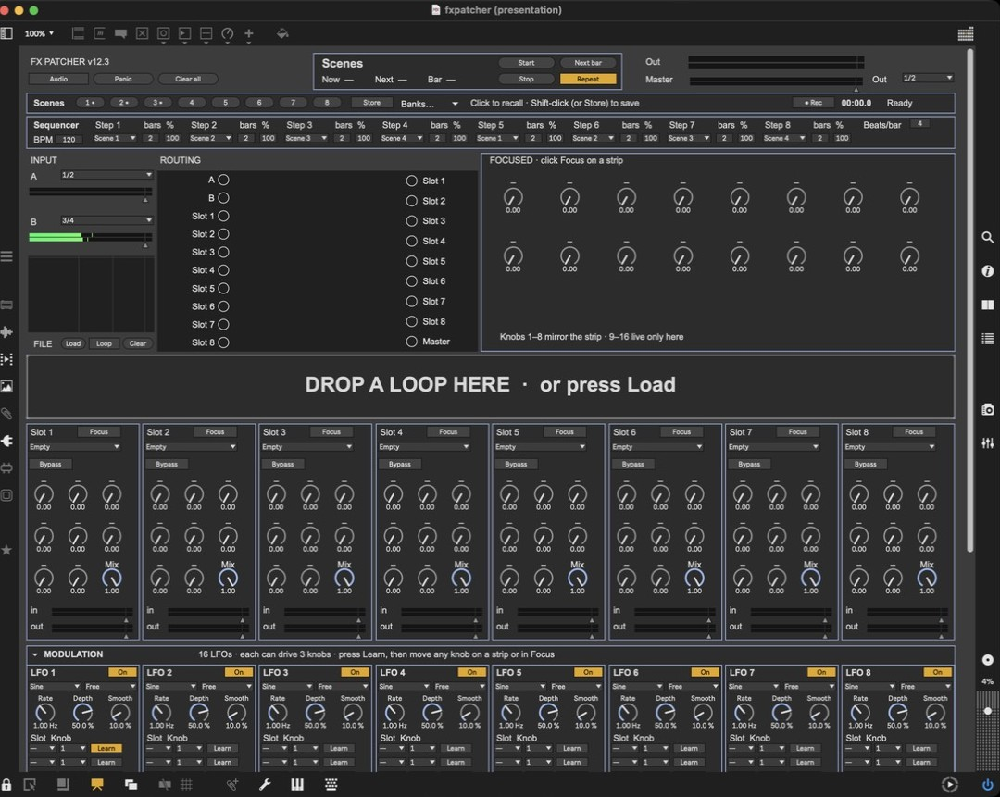
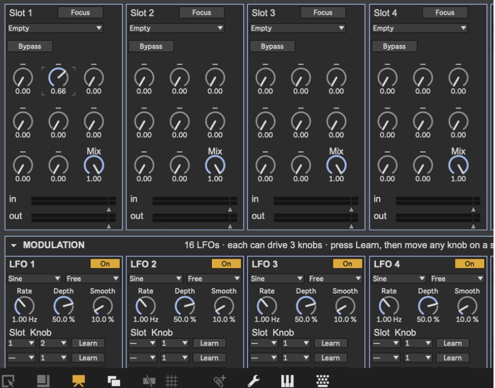
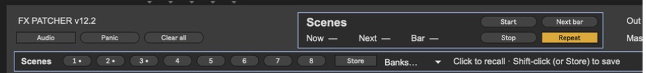

# FX Patcher

A self-contained Max 9 modular effects rack for ambient work. You get eight stereo effect slots, routing you patch with cables, sixteen LFOs, scenes with a scene sequencer, and multitrack recording. Everything is stock Max and ABL objects, so there are no third-party externals or VSTs.

## Requirements

- **Max 9** on macOS. It needs Max 9 because it uses `v8` JavaScript, `node.script` and the ABL objects that ship with Max 9. Windows hasn't been tested.
- An **audio interface**. It's set up for an SSL 12 (inputs 1–4, outputs 1–8), but any interface works. Without one you can still play loops through your Mac's speakers.
- Any sample rate works, and 44.1 kHz is fine. Set it in Max under *Options → Audio Status*.

## Install

1. Download the latest release from the **[Releases page](../../releases)** (the *Source code (zip)* file), or click **Code → Download ZIP** on the main page.
2. Unzip it anywhere. **Keep all the files together in one folder.** The main patch loads the strips, LFO cards, effects and scripts from the same folder, so moving one file out breaks it.
3. Open `fxpatcher.maxpat` in Max 9. It opens in presentation mode, which is the full interface.

If a strip or the Max Console complains that it can't find a `fxm.…` or `.js` file, the files have been split up. Put them back in one folder and reopen.

## First sound in one minute

1. Press **Audio** (top left). It turns orange when audio is running.
2. Check that the **Out** menu (top right) matches the outputs your speakers are on. The default is 1/2.
3. Drag a WAV or AIFF loop onto **DROP LOOP A HERE**, or press **Load** next to FILE A. It starts playing.
4. Set input **A** to **File A**.
5. In **Routing**, click **A** on the left, then **Slot 1** on the right. That draws a cable. Then click **Slot 1** on the left and **Master** on the right.
6. Choose an effect from Slot 1's menu, for example **Shimmer**.

You should now hear the loop through Shimmer, and the **Master** and **Out** meters should move.

**A starter ambient chain:** `A → Slot 1 (Memory) → Slot 2 (Shimmer) → Master`, with Slot 3 (Tape) fed from Slot 2 and sent back into Slot 1 for slow feedback. Then press Learn on LFO 1 and move Memory's **Blur** knob.

## The top bar

| Control | What it does |
|---|---|
| **Audio** | Starts and stops sound. |
| **Panic** | Removes every slot-to-slot cable, which breaks any feedback loop. Cables from A and B, and cables into Master, stay. |
| **Clear all** | Removes every cable. |
| **Scenes box** | Shows the current and next scene, the bar count, and the sequencer's Start, Next bar, Stop and Repeat buttons. |
| **Master** | Overall volume, after a safety limiter. |
| **Out meters** | The signal actually leaving the patch on the outputs you picked. |
| **Out menu** | Which output pair to use: 1/2, 3/4, 5/6 or 7/8. |

## Inputs

**A** and **B** are two stereo inputs, each with a source menu:

- **1/2** or **3/4**: a stereo input pair
- **File A** / **File B**: either of the two file players (see below)
- **Off**

Under each menu is a gain fader with a meter. **Mon** plays that input straight to the outputs, with no cables, so you can check the input is working. Turn Mon off once the input goes through effects, or you'll hear dry and wet together.

## Routing

The **Routing** grid works like a patch bay. Sources are on the left (A, B and the outputs of Slots 1–8). Destinations are on the right (the inputs of Slots 1–8, and Master).

- **Connect:** click a source dot, then a destination dot.
- **Disconnect:** click a cable to select it, then press Delete.

One source can feed several destinations, and several sources can feed one. Slots can feed each other in any order, including feedback loops.

## The file players

There are two independent file players, **File A** and **File B**, stacked one above the other. Each has its own drop zone, its own Load/Loop/Clear buttons, and its own row of File FX knobs — so you can have two loops loaded and playing at once.

| Control | What it does |
|---|---|
| Drop zone | Drag a loop onto it. The player appears once a file is loaded. |
| **Load** | Opens a file picker instead of dragging. |
| **Loop** | Turns looping on or off. |
| **Clear** | Empties the player and brings the drop zone back. |

To pick which loop plays through which input, use the **A**/**B** source menus under INPUT: choose **File A** on one, **File B** on the other (or both on the same input to layer them, or swap them to switch — that's the A/B select). Routing from there into the slots works exactly as it does for any other input.

The small spectrum display under inputs A/B shows the master output.

### File FX

The row under each file player shapes that loop itself: **Speed** (tape-style, 1× in the middle), **Pitch** (±1 octave, keeps the tempo), **Start** and **Length** (which part of the file loops), **Volume**, **Width** (mono to extra-wide), **Tone** (low-pass) and **Pan**. All eight can be LFO targets: pick **File A** or **File B** in an LFO's Slot menu, or press Learn and move one of these knobs. Sweeping Start makes a scanning, granular-style loop.

## Effect slots

Each of the 8 strips has:

- an effect menu
- **Bypass**
- 8 knobs, labelled for the loaded effect
- a **Mix** control: equal-power dry/wet, where 1.00 is fully wet
- **in** and **out** gain faders with meters

Press **Focus** on a strip to open all 16 of its knobs in the big **FOCUSED** panel. Knobs 9–16 only appear there. Changing the effect loads that effect's default settings.

The 15 effects:

| Effect | Description |
|---|---|
| Heat | Analog-style drive and filter, built on two `abl.device.roar~` |
| Drift | A wandering four-line delay |
| Shimmer | Pitched shimmer reverb (`abl.dsp.shimmer~`) |
| Memory | The Field Kit *Drifting Memory* looper/delay |
| Shift | Pitch shifter with feedback |
| Bank | Resonant filter bank |
| Freeze | Spectral-style hold and smear |
| Grain | Granular cloud |
| Tape | Wow, flutter, age, hiss and dropouts |
| Freq | Frequency shifter with feedback |
| Loop | Live looper. It records continuously while **Rec** is up; turn Rec down to hold and repeat the loop. Also has Length, Speed, Erase, Dub, Reverse, Tone and Start. |
| Swell | Ducks on each hit and swells back in. Turn up **Cycle** to make it swell on its own, which works on pads and drones. |
| Filter | Multimode filter with LFO and envelope |
| Crush | Bit and sample-rate reduction with fold |
| Empty | Passes sound through unchanged |

Slots can feed each other in any order, including feedback loops. Each slot's return has a one-block delay, a DC blocker and soft clipping, so feedback stays musical.

## Modulation: 16 LFOs

Each LFO card has:

- **On**
- **Shape:** Sine, Triangle, Saw up, Saw down, Square, S&H, Smooth random, or Drift
- **Sync:** Free (uses **Rate** in Hz), or 8 bars down to 1/16, including triplets. Sync follows the BPM box.
- **Depth:** a negative value inverts the LFO
- **Smooth:** softens steps and jumps
- **Three targets:** each target picks a slot (1–8, or **File A**/**File B** for the two file players) and a parameter **by name**. The list follows the effect loaded in that slot, plus **Mix**.

**Learn** is the quickest way to set a target. Press Learn on one of the target rows, then move any knob on a strip or in the Focus panel. The LFO switches itself on once it has a target.

The knob you set is the centre point, and the LFO moves around it. Any knob an LFO is targeting turns orange and visibly swings, both on the strip and in the Focus panel, so you can always see what's being modulated. Every effect knob (all 16 per slot), each slot's Mix, and all eight File FX knobs can be modulated. When several LFOs hit the same knob, their movements add together.

## Scenes and the scene sequencer

- **To save:** Shift-click a scene number, or press **Store** and then click a number. Saved scenes show a dot.
- **To recall:** click a scene number.
- **What a scene holds:** all effects, knobs and mix settings, the LFO settings, and the routing cables.
- **Banks…** saves or loads the whole set of scenes as a file. The current set is also written to `fxscenes.json` automatically.

The **Sequencer** row has 8 steps. Each step has a scene, a length in bars, and a chance (%) that it fires. Set **BPM** and **Beats/bar**, then press **Start**. **Next bar** jumps to the next step at the next bar line. **Repeat** loops the sequence, and **Stop** ends it.

## Recording

In the **Record** section:

1. Arm any sources you want: Master, A, B and Slots 1–8. Master is armed by default.
2. Pick **24-bit WAV** or **32-bit float WAV**.
3. To change where takes are saved, press **Choose…**. The default is `~/Documents/FX Patcher/Recordings`.
4. Press **● Record** to start and again to stop. The **● Rec** button in the Scenes row does the same thing.

Each armed source records its own WAV file. Every take gets its own dated folder, so nothing is ever overwritten. **Open folder** shows your takes.

## Saving your work

- **Scenes** are saved automatically to `fxscenes.json` next to the patch, so they come back the next time you open it.
- **Banks… → Save bank** keeps a whole set of scenes as a separate file. **Load bank** brings it back.
- When you reopen the patch, store what you're doing as a scene first. A reopened patch starts with no file loaded and no cables until you recall a scene.

## Troubleshooting

| Problem | What to check |
|---|---|
| No sound at all | **Audio** is on, and *Options → Audio Status* shows your interface as the output. The **Out** menu is on the right pair. Something is cabled to **Master**. |
| Master meter moves but Out doesn't | The **Out** menu is on a pair your interface doesn't have. |
| Input meters are dead | The **A**/**B** source menu, the input gain fader, and the input in *Audio Status*. |
| An effect is silent | Its **Mix** isn't at 0, **Bypass** is off, and a cable feeds the slot. Open `fxtest.maxpat` to print every effect's output level to the Max Console. |
| Feedback gets out of hand | Press **Panic**. |
| An LFO does nothing | **On** is lit, **Depth** isn't 0, and a Slot and Parameter are picked. The targeted knob should turn orange. |
| Shift-click doesn't save a scene | Use **Store** and then click the number instead. |

## Known limitations

- Tempo comes from the **BPM** box. Following Ableton's clock isn't built yet.
- There's no true sidechain yet. Swell stands in for ducking.
- macOS only so far.

## Files

| File | What it is |
|---|---|
| `fxpatcher.maxpat` | Main patch (open this) |
| `fx.slot.maxpat` | One effect strip, used 8 times |
| `fx.lfo.maxpat` | One LFO card, used 16 times |
| `fx.filectl.maxpat` | File FX knob row, used twice (LFO targets "File A" and "File B") |
| `fxm.*.maxpat` | The effect modules, loaded into each slot |
| `fxseq.js` | Scenes and sequencer |
| `fxlfo.js` | LFO engine |
| `fxmod.js` | Per-slot "knob + LFO" combiner |
| `fxrec.js` | Recorder take folders and settings |
| `fxtest.maxpat` | Self-test: runs every effect on a test tone and prints each one's output level to the Max Console |
| `make_fxpatcher.py` | Python generator that writes all the `.maxpat` files: `python3 make_fxpatcher.py ./`. Only needed if you want to change the design in code. |

## Roadmap

- Follow Ableton's clock over IAC MIDI
- A real sidechain/duck bus
- 80 ms crossfade between scenes
- Collapsible sections
