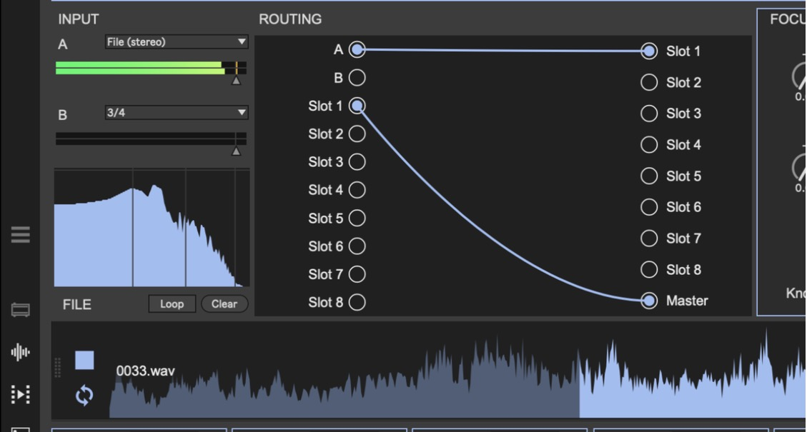

# FX Patcher

A standalone Max 9 modular effects rack for ambient work. You get eight stereo effect slots, routing you patch with cables, sixteen LFOs, scenes with a scene sequencer, and multitrack recording. Everything is stock Max and ABL objects, so there are no third-party externals or VSTs.

## Requirements

- Max 9 (the scene and LFO engines use the `v8` JavaScript object, and the recorder uses `node.script`)
- An audio interface. It's set up for an SSL 12 (inputs 1–4, outputs 1–8), but any interface works.
- 44.1 kHz is fine

## Getting started

1. Download or clone this repo and keep all the files together in one folder.
2. Open `fxpatcher.maxpat` in Max. It opens in presentation mode.
3. Press **Audio** (top left) to start sound.
4. Pick the output pair with the **Out** menu (top right). The default is 1/2.
5. Give it a sound source. Either:
   - **Drop a loop** (WAV/AIFF) onto the big **DROP A LOOP HERE** area, or press **Load** next to FILE. Set input **A** to **File**.
   - Or set input **A** or **B** to your interface inputs (1/2, 3/4, or a single mono input).
6. **Just listen first (optional):** press **Mon** next to A or B to hear that input dry on the outputs without any cables. Turn it off once you patch the input through effects, or you'll hear dry and wet together.
7. **Patch it.** In the **Routing** grid, click a dot on the left (a source) and then a dot on the right (a destination) to draw a cable. Start with `A → Slot 1` and `Slot 1 → Master`. Click a cable to select it and press Delete to remove it.
8. Choose an effect from the menu at the top of Slot 1.

The **Out** meters (top right) show the signal actually leaving the patch on the outputs you picked. If **Master** moves but **Out** doesn't, check the Out menu. If both move and you hear nothing, check Max's *Options → Audio Status* and make sure your interface is the output device.

## The file player

| Control | What it does |
|---|---|
| Drop zone | Drag a loop onto it. The player appears once a file is loaded. |
| **Load** | Opens a file picker instead of dragging. |
| **Loop** | Turns looping on or off. |
| **Clear** | Empties the player and brings the drop zone back. |

The small spectrum display under inputs A/B shows the master output.

## Effect slots

Each of the 8 strips has an effect menu, **Bypass**, 8 knobs, a **Mix** control (equal-power dry/wet), and in/out gain with meters. Press **Focus** on a strip to open all 16 of its knobs in the big **FOCUSED** panel. Knobs 9–16 only appear there.

The 15 effects:

| Effect | Description |
|---|---|
| Heat | Analog-style drive and filter, built on two `abl.device.roar~` |
| Drift | A wandering four-line delay |
| Shimmer | Pitched shimmer reverb (`abl.dsp.shimmer~`) |
| Memory | The Field Kit *Drifting Memory* looper/delay |
| Shift | Pitch shifter with feedback |
| Bank | Resonant filter bank |
| Freeze | Spectral-style hold and smear |
| Grain | Granular cloud |
| Tape | Wow, flutter, age, hiss and dropouts |
| Freq | Frequency shifter with feedback |
| Loop | Live looper. It records continuously while **Rec** is up; turn Rec down to hold and repeat the loop. Also has Length, Speed, Erase, Dub, Reverse, Tone and Start. |
| Swell | Ducks on each hit and swells back in. Turn up **Cycle** to make it swell on its own, which works on pads and drones. |
| Filter | Multimode filter with LFO and envelope |
| Crush | Bit and sample-rate reduction with fold |
| Empty | Passes sound through unchanged |

Slots can feed each other in any order, including feedback loops. Each slot's return has a one-block delay, a DC blocker and soft clipping, so feedback stays musical.

## Modulation: 16 LFOs

Each LFO card has:

- **On**
- **Shape:** Sine, Triangle, Saw up, Saw down, Square, S&H, Smooth random, or Drift
- **Sync:** Free (uses **Rate** in Hz), or 8 bars down to 1/16, including triplets. Sync follows the BPM box.
- **Depth:** a negative value inverts the LFO
- **Smooth:** softens steps and jumps
- **Three targets:** each target picks a slot and a knob number

**Learn** is the quickest way to set a target. Press Learn on one of the target rows, then move any knob on a strip or in the Focus panel. The LFO switches itself on once it has a target.

The knob you set is the centre point, and the LFO moves around it. Any knob an LFO is targeting turns orange and visibly swings, so you can always see what's being modulated. When several LFOs hit the same knob, their movements add together.

## Scenes and the scene sequencer

- **To save:** Shift-click a scene number, or press **Store** and then click a number. Saved scenes show a dot.
- **To recall:** click a scene number.
- **What a scene holds:** all effects, knobs and mix settings, the LFO settings, and the routing cables.
- **Banks…** saves or loads the whole set of scenes as a file. The current set is also written to `fxscenes.json` automatically.

The **Sequencer** row has 8 steps. Each step has a scene, a length in bars, and a chance (%) that it fires. Set **BPM** and **Beats/bar**, then press **Start**. **Next bar** jumps to the next step at the next bar line. **Repeat** loops the sequence, and **Stop** ends it.

## Recording

In the **Record** section, arm any mix of Master, A, B and Slots 1–8, then press **● Record**. Each armed source records its own WAV file (24-bit or 32-bit float). Every take gets its own dated folder, and nothing is ever overwritten. **Open folder** shows your takes. The default location is `~/Documents/FX Patcher/Recordings`.

## Files

| File | What it is |
|---|---|
| `fxpatcher.maxpat` | Main patch (open this) |
| `fx.slot.maxpat` | One effect strip, used 8 times |
| `fx.lfo.maxpat` | One LFO card, used 16 times |
| `fxm.*.maxpat` | The effect modules, loaded into each slot |
| `fxseq.js` | Scenes and sequencer |
| `fxlfo.js` | LFO engine |
| `fxmod.js` | Per-slot "knob + LFO" combiner |
| `fxrec.js` | Recorder take folders and settings |
| `fxtest.maxpat` | Self-test: runs every effect on a test tone and prints each one's output level to the Max Console |
| `make_fxpatcher.py` | Python generator that writes all the `.maxpat` files: `python3 make_fxpatcher.py ./` |

## Roadmap

- Follow Ableton's clock over IAC MIDI
- A real sidechain/duck bus
- 80 ms crossfade between scenes
- Collapsible sections
